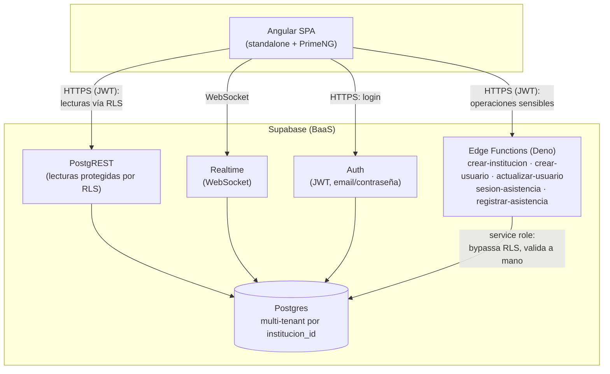

<div align="center">

# RegistrApp

### Capstone-001D — DUOC UC, sede Alameda

Plataforma web de gestión de asistencia mediante código QR firmado. Sustituye la pasada de lista tradicional en papel por un código QR de vigencia breve: el responsable proyecta el código, la persona lo abre con su cámara y el servidor registra la marca al instante, visible en vivo para el responsable.

<p>
  
  
  
  
  
  
  
  
  
  
  
  
</p>

<sub>(pasa el cursor sobre cada ícono para ver el nombre de la herramienta)</sub>

</div>

---

## Contenido

- [Tecnologías utilizadas](#tecnologías-utilizadas)
- [Demo en vivo](#demo-en-vivo)
- [Cómo ejecutar el proyecto localmente](#cómo-ejecutar-el-proyecto-localmente)
- [Despliegue](#despliegue)
- [Equipo](#equipo)
- [Metodología de trabajo](#metodología-de-trabajo)
- [Arquitectura de la solución](#arquitectura-de-la-solución)

---

## Tecnologías utilizadas

| Capa | Tecnologías |
|---|---|
| **Frontend** | Angular 18 (standalone components + signals), PrimeNG, angularx-qrcode, @zxing/browser |
| **Backend / BaaS** | Supabase: Postgres, Auth, Edge Functions (Deno/TypeScript), Realtime |
| **Datos y reportes** | SheetJS (carga masiva CSV/Excel), pdfmake (exportación a PDF) |
| **Despliegue** | Vercel (frontend) |

## Demo en vivo

> (pendiente — se agrega el enlace de Vercel una vez desplegado)

## Cómo ejecutar el proyecto localmente

### Requisitos previos

- [Node.js](https://nodejs.org) `18.19.1+`, `20.11.1+` o `22+` (recomendado: la versión LTS más reciente)
- npm (viene incluido con Node.js)
- Git

### Pasos

1. Clonar el repositorio y entrar a la carpeta del proyecto Angular:
   ```bash
   git clone https://github.com/VicenteMoyaDuoc/-capstone_2026_duoc_alameda
   cd -capstone_2026_duoc_alameda/registrapp
   ```
2. Instalar las dependencias:
   ```bash
   npm install
   ```
3. **No hay que crear ni configurar ningún backend propio.** `src/environments/environment.ts` y `environment.development.ts` ya traen la URL y la clave pública ("anon key") del **mismo proyecto Supabase del equipo**, que ya está desplegado y en línea (base de datos, políticas de seguridad y Edge Functions funcionando). Cualquiera que clone el repo se conecta automáticamente a ese backend compartido — es una clave *publicable*, pensada para ir en el cliente; el acceso real a los datos lo controla Row Level Security en la base de datos, no esta clave. (Solo habría que cambiarla si alguien quisiera apuntar a un proyecto Supabase distinto, propio.)
4. Levantar el servidor de desarrollo:
   ```bash
   npm start
   ```
5. Abrir [http://localhost:4200](http://localhost:4200) en el navegador. La app redirige automáticamente a `/login`.
6. **Crear una cuenta propia** (no hay usuarios de prueba hardcodeados, por seguridad). Esto no crea un backend nuevo — solo una institución de prueba más, dentro del mismo Supabase del equipo:
   1. En la pantalla de login, hacer clic en **"¿Nueva institución? Regístrala aquí"**.
   2. Completar con un correo real y una contraseña (mínimo 10 caracteres).
   3. Revisar ese correo: Supabase envía un enlace de confirmación. Hacer clic en él.
   4. Volver a `/login` e iniciar sesión con esa cuenta ya confirmada.
   5. Completar el formulario de la institución: nombre, tipo (**educativa** → cursos y asignaturas, o **corporativa** → departamentos) y el nombre completo del administrador.
   6. Quedarás en el dashboard de administrador de tu propia institución, lista para crear cursos/departamentos, usuarios (responsables y miembros) y empezar a generar sesiones de asistencia por QR.

## Despliegue

El proyecto está pensado para desplegarse en Vercel, apuntando el **Root Directory** a la carpeta `registrapp` (ahí vive el proyecto Angular, no en la raíz del repositorio).

## Equipo

| Integrante | Rol |
|---|---|
| Vicente Moya | Desarrollador |
| Marcos Tapia | Desarrollador |
| Felipe Antonio Krauss | Docente |

## Metodología de trabajo

Scrum, con sprints de dos semanas, planificación por épicas, estimación en puntos de función y control de avance en tablero.

## Arquitectura de la solución

Arquitectura de tres capas:

- **Presentación (Frontend):** Angular SPA — estado visual e interfaz de usuario.
- **Lógica (Edge Functions):** validación y reglas de negocio sensibles, ejecutadas fuera del cliente (Deno/TypeScript, con la *service role key*).
- **Acceso a datos (BD):** PostgreSQL en Supabase, con Row Level Security (RLS) como política nativa de aislamiento por institución.


